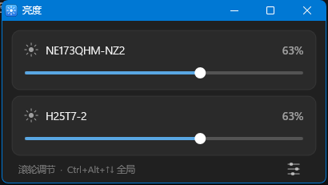
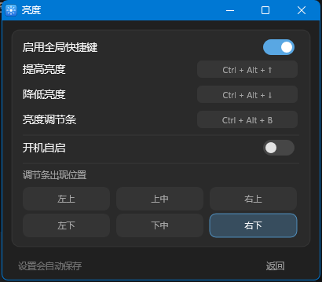

# Luma · 显示器亮度控制

[](LICENSE)
[](https://github.com/nekolovebed/adjustMonitorTool/releases)

一个 **约 470 KB 的单文件小工具**，用来调节 Windows「设置 → 系统 → 显示」里调不到的**外接显示器**亮度。

笔记本内屏 Windows 自带的滑块可以调，外接屏不行 —— 因为那个滑块只走 ACPI/WMI 的内屏通道。外接屏必须走 **DDC/CI**，这个工具就是把这条通道做成一个直接可用的小窗。



## 功能

- 自动列出所有显示器，一块屏一个滑块，实时读写硬件背光
- 拖动 / 点击 / 滚轮调节，`0`–`100` 全区间可用
- 全局快捷键：`Ctrl + Alt + ↑ / ↓` 调亮度，`Ctrl + Alt + B` 唤出迷你调节条（窗口关掉也生效）；三个热键都能**单独开关、自定义按键**
- 迷你调节条：**还原 Win11 原生 OSD 形态**（深灰圆角浮层、无拇指填充条、Regular 字重数字），可拖动、滚轮调节，2.4 秒后自动淡出，出现位置可选 6 个角
- 迷你条右侧箭头可展开显示器列表：切换「全部显示器 / 单块屏」，调光目标即时生效
- 每 5 秒与硬件同步：用显示器实体按键改过亮度，滑块会自动跟上
- 托盘图标：单击显示/隐藏，右键菜单可快速 ±5%、退出
- 热插拔显示器、切换投影（`Win+P`）后窗口自动适配
- Windows 11 原生 **Mica** 材质 + 系统原生标题栏（按钮高亮、关闭变红都是系统的）
- 强调色跟随系统个性化设置

## 使用

双击 `Luma.exe` 即可，**无需安装、无需运行库、不联网**。

| 操作 | 效果 |
| --- | --- |
| 拖动 / 点击滑块 | 调节对应显示器亮度 |
| 在滑块上滚轮 | 每次 ±5% |
| `Ctrl + Alt + ↑ / ↓` | 全局亮度 ±5% |
| `Ctrl + Alt + B` | 唤出迷你亮度调节条（默认，可在设置里改） |
| 迷你条右侧箭头 | 展开显示器列表，切换调光目标 |
| 右下角滑杆图标 | 打开设置（快捷键单独开关 / 自定义 / 调节条位置 / 开机自启） |
| 标题栏 `—` `□` `✕` | 最小化 / 最大化 / 退出 |
| 托盘图标 | 单击显示/隐藏；右键菜单可 ±5%、退出 |
| `F5` | 重新扫描显示器 |
| `Esc` | 隐藏窗口（托盘图标可唤回） |

开机自动运行：`Win+R` 输入 `shell:startup`，把 `Luma.exe` 的快捷方式丢进去。

## 它是怎么做到的

| 目标 | 通道 |
| --- | --- |
| 外接显示器 | DDC/CI（`dxva2.dll`：`GetPhysicalMonitorsFromHMONITOR` + `GetVCPFeatureAndVCPFeatureReply` / `SetVCPFeature`，VCP 指令 `0x10`） |
| 笔记本内屏 | WMI（`root\WMI` : `WmiMonitorBrightnessMethods.WmiSetBrightness`） |

几个实现上的坑，都踩过并修好了，写在代码注释里：

- `GetPhysicalMonitorsFromHMONITOR` 在某些机器上**第一次调用返回空句柄、第二次才给有效句柄**，且中途不能 `DestroyPhysicalMonitors`，否则会一直拿不到。
- 内屏即使也能开出 DDC 句柄，写入通常也无效，所以内屏一律强制走 WMI。
- WMI 的 `WmiSetBrightness` 里 `Timeout` 参数必须用 `VT_I4`，用 `VT_UI4` 会返回 `0x80041005` 类型不匹配。

## 显示器调不动？

1. 显示器 OSD 菜单里的 **DDC/CI 选项可能被关掉了**（多数品牌默认开启，部分国产屏默认关闭）。
2. 中间经过 **KVM 切换器、HDMI 分配器、部分扩展坞**，它们不透传 DDC。
3. 用了 **HDMI 转 VGA / DP 转 HDMI 的被动转接头**。
4. 显示器刚从睡眠唤醒时头一两次读取会失败，按 `F5` 重新扫描即可。

排除以上情况后仍不行，说明这台显示器没有实现 DDC 背光寄存器，软件层面无解。

## 编译

需要 MSYS2 的 `ucrt64` 工具链（`g++` + `windres`）：

```bash
bash build.sh
```

产物在 `dist/Luma.exe`。

依赖 `dwmapi d2d1 dwrite d3d11 dxgi dcomp dxva2 shell32 ole32 oleaut32 wbemuuid advapi32 gdi32 user32` —— 全部是 Windows 自带组件，静态链接 MinGW 运行库，发布时不需要带任何 DLL。

## 项目结构

```
src/main.cpp        窗口、Direct2D 渲染、DirectComposition、交互、托盘、热键
src/brightness.cpp  DDC/CI + WMI 调光后端
src/app.rc|manifest 图标、版本信息、Per-Monitor V2 DPI 清单
tools/mkicon.cpp    图标生成器（多尺寸 32bpp ICO，构建时调用）
tools/rangeprobe.cpp DDC 读数诊断（排查某台显示器能不能调）
```

代码约 1600 行，无第三方库。

## 设置

点主窗口右下角的滑杆图标进入设置：



| 选项 | 说明 |
| --- | --- |
| 三个快捷键各自的开关 | 「提高亮度 / 降低亮度 / 亮度调节条」可**分别**启用或关闭，关掉的那个热键立即释放 |
| 自定义快捷键 | 点快捷键的按键框后按下新组合即可录入（`Esc` 取消，必须带修饰键）；注册失败（被占用）时标签变红 |
| 调节条出现位置 | 左上 / 上中 / 右上 / 左下 / 下中 / 右下，点击即预览 |
| 开机自启 | 在当前用户 `Run` 键写入一项，关掉立即删除，不写服务、不写计划任务 |

设置即时生效并自动保存。

## 兼容性

- Windows 11（Mica 材质）；Windows 10 1809+ 可运行，但材质会退化为纯色深底。
- 仅 x64，用 MinGW-w64 编译，不依赖 .NET / WinUI / VC 运行库。

## 免责声明

**使用前请阅读 [DISCLAIMER.md](DISCLAIMER.md)。** 简要说明：

本软件按「现状」提供，不附带任何担保。它通过厂商公开的 DDC/CI 接口直接写入显示器背光寄存器，属于受支持的正常操作，但不同显示器实现差异很大，可能出现黑屏、闪烁、设置不生效等情况，**风险由使用者自行承担**。请确保你能用显示器实体按键恢复亮度后再使用。作者不对因使用本软件造成的任何直接或间接损失负责。

本软件不联网、不收集任何数据。调光操作直接作用于你本机的显示硬件；设置保存在 `%APPDATA%\Luma\settings.ini`，只有你手动打开「开机自启」时才会在 `HKCU\Software\Microsoft\Windows\CurrentVersion\Run` 写入一项（关掉即删除）。

## 许可与来源

本项目使用 [MIT License](LICENSE)。你可以自由使用、修改、再分发，**只需保留版权声明与本许可声明**（即「注明来源」）。

- 本项目为**独立实现**，未使用、未复制任何第三方开源项目的代码。
- 与任何第三方软件**无任何关联、无隶属关系**，不包含其任何代码、图标或资源。
- 全部功能基于 Windows 公开 API（`dxva2.dll`、WMI、Direct2D、DirectComposition、DWM）。
- 「Windows」是 Microsoft Corporation 的商标；文中提及的其他软件与硬件名称归各自所有者所有。本项目与 Microsoft 及各显示器厂商无隶属关系，也未获其背书。
